<picture>
  <source media="(prefers-color-scheme: dark)" srcset="assets/banner.svg" />
  
</picture>

---

I build production web applications end to end: typed React and Next.js frontends, REST APIs on Node.js and Express, and data layers on PostgreSQL and MongoDB. I care about clean component architecture, efficient data fetching, and shipping reliably. Currently strengthening backend fundamentals through daily DSA practice and system design.

## 💼 Experience

**Kirrhosoft** · Junior Software Engineer · *May 2026 – Present*
- Built **10+ reusable React/TypeScript components** adopted across **3 product modules**, cutting UI development time by **~30%**.
- Integrated **15+ REST endpoints** with React Query caching, reducing redundant API requests by **~40%**.
- Led a dashboard UI redesign that improved task completion rate.
- Shipped every sprint on time in a 5-person Agile team with **zero critical production bugs**.

**Kirrhosoft** · Software Development Intern · *Dec 2025 – Apr 2026*
- Built high-density data grids with TanStack Table, including server-side pagination, filtering, and search.
- Built validation-heavy forms with React Hook Form, shadcn/ui, and Radix UI.

## 🚀 Featured Projects

### SwiftParcel — Courier & Logistics Platform
Multi-role delivery platform for customers, couriers, and admins, backed by an Express and PostgreSQL API.
- Parcel booking with live fee estimates, Stripe Checkout, and public tracking by tracking number
- Courier workflow with status updates, proof-of-delivery uploads, and earnings
- Admin analytics, hub and zone management, role management, and a searchable audit log; English and Bangla UI

`Next.js 16` `React 19` `TypeScript` `TanStack Query` `Zustand` `Zod` `Express` `PostgreSQL` `Stripe`

### RentNest — Rental Marketplace
Marketplace connecting tenants and landlords, with admin moderation.
- JWT authentication with role-aware routing and protected middleware
- Role-based dashboards: property management, rental requests, user management, payment history
- Stripe Payment Intents, optimistic updates, and shared Zod validation

`Next.js 16` `React 19` `TypeScript` `TanStack Query` `TanStack Table` `Stripe` `REST API`

### ShelfShare — Community Book-Sharing Platform *(team project)*
Platform for lending, borrowing, and discovering books within a community.
- NextAuth authentication with protected routes and session management
- Stripe payments for borrowing and lending, plus an AI assistant for book queries

`Next.js` `TypeScript` `Redux` `NextAuth` `Stripe` `Tailwind CSS`

## 🛠️ Tech Stack

  
   
  

**Also:** TanStack Query · TanStack Table · React Hook Form · Zod · Zustand · shadcn/ui · Radix UI · NextAuth · JWT · Stripe · REST APIs

## 🎓 Education

**B.Sc. in Computer Science and Engineering** — North South University, Dhaka (2024)

---

Happy to talk React, system design, or a good DSA problem.

